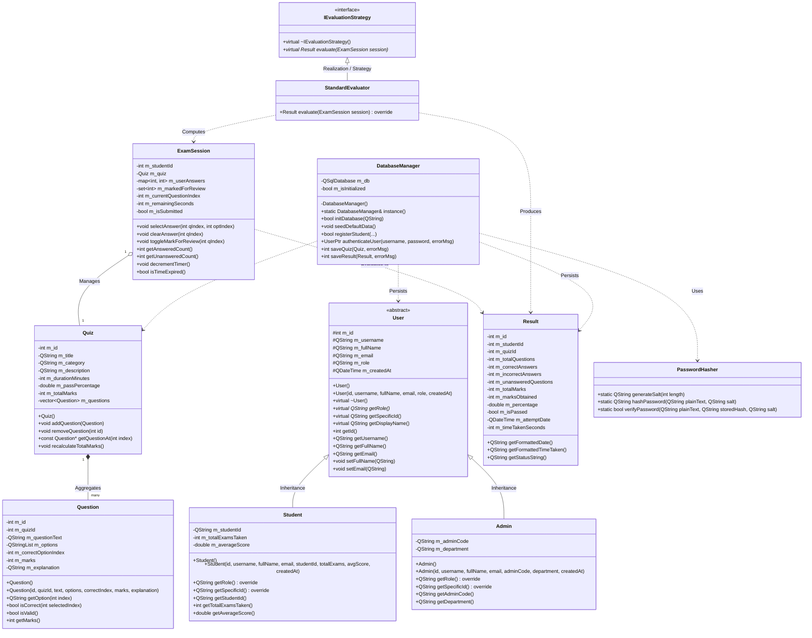
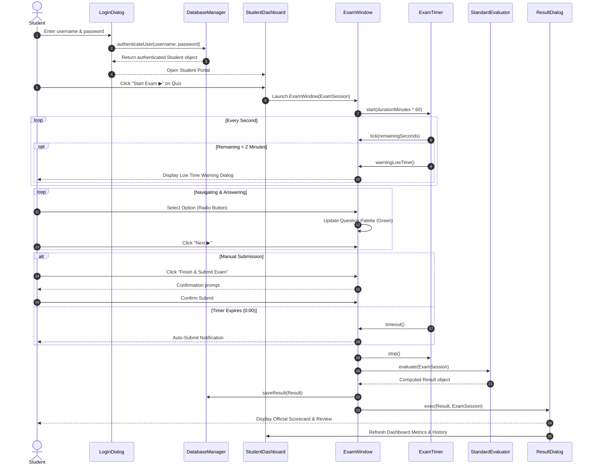
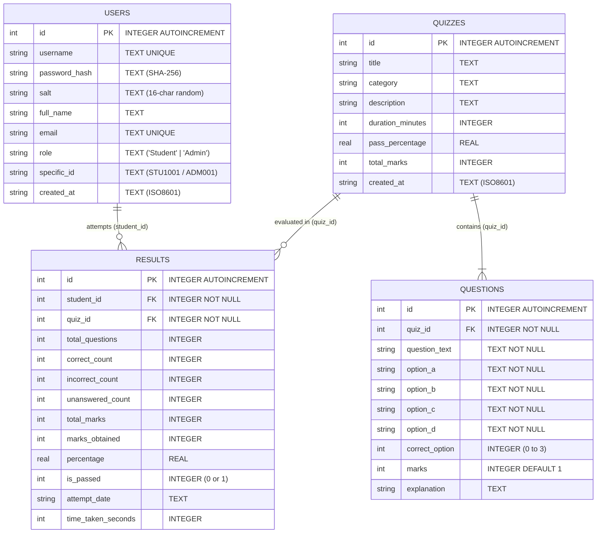

# 📊 Online Examination System - UML Diagrams & System Architecture

This document contains complete UML design models representing the Object-Oriented architecture of the Online Examination System mini project.

---

## 1. Class Diagram (OOP Design)

---

## 2. Sequence Diagram: Student Examination Flow

---

## 3. Database Entity-Relationship (ER) Diagram

